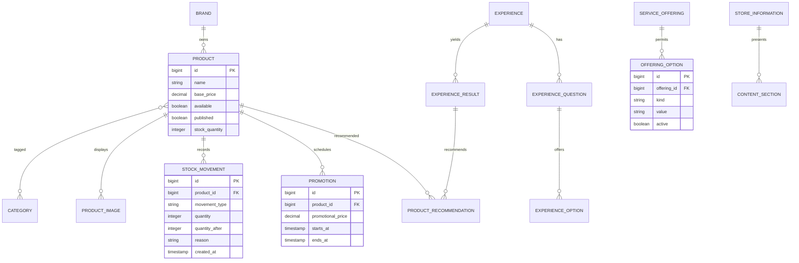

# Modelo de dados — referência para evolução do PostgreSQL

**Importante:** este diagrama combina entidades já observadas no código e extensões **propostas** pelas regras aprovadas. Não é um retrato literal do banco atual; nenhuma migration nova foi criada.

## Visão conceitual

**Nota:** o diagrama mostra intenções conceituais; a entidade `StoreInformation` não necessariamente possui relação física com `ContentSection` no banco atual. Relações e cardinalidades devem ser ajustadas ao modelo físico aprovado.

## Dicionário inicial
| Entidade | Chave | Atributos importantes | Estado |
|---|---|---|---|
| Product | Long ID | nome, descrição, preço base BigDecimal, marca, publicação, disponibilidade | Existente; faltam saldo e movimentos |
| Brand / Category | Long ID | nome, ativo | Existentes |
| ProductImage | Long ID | URL, posição, produto | Existente |
| StockMovement | Proposta | produto, tipo, quantidade, saldo posterior, data, ator, motivo | Nova; fase 2 |
| Promotion | Proposta | produto, preço promocional, intervalo UTC, estado | Nova; fase 3 |
| Experience / Question / Option / Result | IDs atuais | perguntas, opções e resultado | Existentes; vínculo de recomendações a evoluir |
| ProductRecommendation | Proposta | resultado, produto e posição | Nova; fase 4 |
| ServiceOffering | Long ID | tipo CANDLE/WORKSHOP/RENTAL, título, preço opcional, publicação | Existente |
| OfferingOption | Proposta | tipo aroma/cor/embalagem, valor, ativo e vínculo à vela | Nova; fase 5 |
| StoreInformation | Persistência atual | WhatsApp e informações institucionais | Existente |
| ContentSection / Campaign | IDs atuais | conteúdo e banners | Existentes |
| AdministrativeAudit | Proposta | ator, ação, recurso, timestamp e resultado | Evolução da auditoria mínima; fase 7 |
| PasswordResetToken / EmailOutbox | Propostas | hash de token, validade, estado e tentativas | Fase 1, sob aprovação técnica |

## Persistência e integridade
- Persistir dinheiro como `BigDecimal` Java e `NUMERIC(12,2)` ou precisão equivalente validada.
- Usar Flyway, acrescentando novas versões em vez de editar V1–V6.
- Fazer alterações de saldo em transação atômica, com trava/controle de versão conforme testes de concorrência.
- Rejeitar saldos negativos; proteger relações por FKs e constraints, além da Bean Validation.
- Promoções sem sobreposição: validar em serviço transacional e, quando adequado, reforçar no banco.
- Guardar registros de auditoria imutáveis por operação, sem senhas e tokens.
- Políticas de retenção e dados pessoais precisam ser conferidas antes da produção.

## Histórico vs. aprovado
O briefing inicial dizia que estoque automatizado ficaria fora. A revisão posterior o incluiu no MVP; portanto não remover essa exigência com base no briefing antigo.
