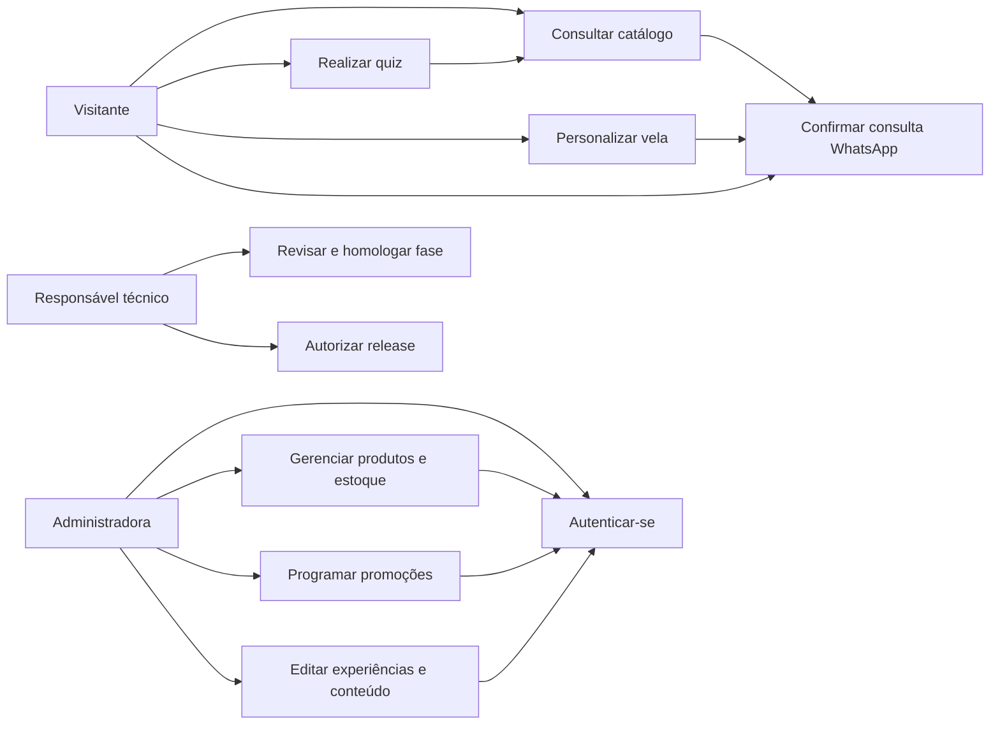

# Casos de uso — MVP proposto

**Estado:** pronto para revisão de critérios, não homologado. Atores: visitante, administradora única e responsável técnico.

## Diagrama

## UC-01 — Buscar e consultar produto
- **Ator:** visitante. **Pré-condição:** catálogo acessível; produto publicado.
- **Fluxo:** listar → pesquisar/filtrar → abrir detalhe → obter preço efetivo e disponibilidade atual.
- **Alternativas:** sem resultados, filtros inválidos, produto arquivado/retirado, instabilidade da API.
- **Pós-condição:** nenhuma venda, reserva ou pedido persistido.
- **Aceite:** preço BRL correto; filtros combinados; indisponível não anunciado como comprável.

## UC-02 — Confirmar solicitação via WhatsApp
- **Ator:** visitante. **Pré-condição:** item/serviço publicado; contato oficial configurado.
- **Fluxo:** escolher item → abrir confirmação → backend revalidar elegibilidade/valor/opções → exibir mensagem fixa adequada → confirmar → abrir link oficial.
- **Alternativas:** preço alterado (atualizar visão e exigir confirmação), indisponível (bloquear), opções inválidas (corrigir), navegador sem abertura automática (link manual/cópia).
- **Pós-condição:** mensagem preparada, sem garantia de envio nem registro de pedido.
- **Aceite:** nunca abrir automaticamente sem confirmação atual.

## UC-03 — Registrar movimentação de estoque
- **Ator:** administradora. **Pré-condição:** sessão + CSRF válidos; produto existente.
- **Fluxo:** selecionar produto → informar tipo/quantidade/justificativa → validar → transação atômica → atualizar saldo → registrar movimento/ator.
- **Alternativas:** operação resultaria em saldo negativo (rejeitar); conflitos concorrentes (garantir consistência).
- **Aceite:** saldo e ledger íntegros.

## UC-04 — Publicar promoção
- **Ator:** administradora. **Fluxo:** informar preço e intervalo → validar sobreposição → salvar → exibir preço efetivo na janela.
- **Alternativas:** período inválido, preço inválido, conflito temporal.
- **Aceite:** promoções conflitantes não são persistidas.

## UC-05 — Realizar quiz
- **Ator:** visitante. **Fluxo:** responder perguntas → validar alternativas → calcular perfil → apresentar resultado → mostrar até três sugestões elegíveis.
- **Alternativas:** nenhuma sugestão disponível → resultado ainda aparece, sem produto repetido.
- **Aceite:** regras determinísticas e itens publicados/disponíveis.

## UC-06 — Recuperar acesso administrativo
- **Ator:** administradora. **Fluxo:** solicitar recuperação → receber link de uso único via canal autorizado → confirmar nova senha → invalidar token.
- **Alternativas:** token vencido/usado e abuso de tentativas → rejeição segura, sem expor existência da conta.
- **Aceite:** token de 15 min, logs sem segredos.

## UC-07 — Homologar fase
- **Ator:** responsável técnico. **Pré-condição:** US obrigatórias Done e evidências testadas.
- **Fluxo:** conferir CI, staging, docs e riscos → registrar HML-### → aprovar ou recusar justificadamente.
- **Aceite:** não confundir aprovação técnica com autorização de produção.
